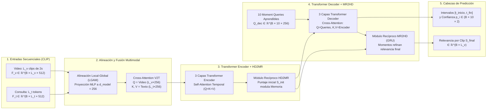

# TR-DETR: Localización de Momentos y Detección de Highlights en Video mediante Transformer Encoder–Decoder

**Proyecto Final — Procesamiento de Datos Secuenciales con Deep Learning**  
**Especialización en Inteligencia Artificial · Universidad Autónoma de Occidente (UAO)**  
**Docente:** Dra. Natalie Belandia  
**Integrantes:** Juliana Campuzano · Jorge Iván González · Juan José Mosquera · David Alvarado  

---

## 1. Resumen (Abstract)

Encontrar un momento específico dentro de un video de larga duración a partir de una descripción en lenguaje natural (por ejemplo, *"el hombre abre la puerta del carro"*) exige tradicionalmente inspeccionar la grabación de principio a fin de forma manual. En este proyecto se implementa y analiza el flujo de inferencia de **TR-DETR (*Task-Reciprocal Transformer for Joint Moment Retrieval and Highlight Detection*)**, una arquitectura **Transformer Encoder–Decoder** propuesta en **AAAI 2024** que resuelve de manera conjunta dos tareas sobre datos secuenciales multimodales: la **Recuperación de Momentos (*Moment Retrieval*, MR)** y la **Detección de Momentos Destacados (*Highlight Detection*, HD)**.

El sistema recibe como entrada una secuencia temporal de clips de video (extraídos cada $\Delta t = 2.0\text{ s}$ y codificados mediante **CLIP ViT-B/32**) junto con la secuencia de tokens de una consulta en lenguaje natural. A través de un módulo de **Alineación Local-Global (LGAM)**, un bloque de **Atención Cruzada Video-a-Texto (V2T)**, un **Transformer Encoder–Decoder** con $N_q = 10$ *Moment Queries* aprendibles y un mecanismo bidireccional de **Reciprocidad entre Tareas (`HD2MR` y `MR2HD` con celda GRU)**, el modelo predice simultáneamente las coordenadas temporales $[\text{inicio}, \text{fin}]$ del evento buscado y una curva continua de relevancia (*saliency score*) clip por clip. Se presenta una implementación modular en PyTorch junto con una interfaz gráfica interactiva en **Streamlit** que permite cargar videos propios, ejecutar consultas en vivo e inspeccionar la creación y dimensiones de los tensores **Query ($Q$)**, **Key ($K$)** y **Value ($V$)** en cada etapa de atención.

---

## 2. Introducción

### 2.1 Artículo Base y Repositorios Oficiales
- **Artículo científico base:** H. Sun, M. Zhou, W. Chen y W. Xie, “TR-DETR: Task-Reciprocal Transformer for Joint Moment Retrieval and Highlight Detection,” en *Proc. AAAI Conf. Artificial Intelligence*, vol. 38, no. 5, 2024, pp. 4998–5007. Preprint: `arXiv:2401.02309`.
- **Repositorio original de los autores:** [https://github.com/mingyao1120/TR-DETR](https://github.com/mingyao1120/TR-DETR)
- **Framework de inferencia reproducible y pesos preentrenados (QVHighlights, features CLIP):** [https://github.com/line/lighthouse](https://github.com/line/lighthouse) y [https://zenodo.org/records/13960580](https://zenodo.org/records/13960580) (`clip_tr_detr_qvhighlight.ckpt`, licencias MIT y Apache 2.0).

### 2.2 Contexto del Problema y Motivación
El crecimiento exponencial de contenido audiovisual en plataformas educativas, sistemas de videovigilancia, deportes y medios digitales ha vuelto ineficiente la búsqueda manual de eventos dentro de videos. A diferencia de la clasificación de video tradicional, la localización temporal guiada por lenguaje natural requiere:
1. **Alinear dos dominios secuenciales heterogéneos:** una secuencia visual continua discretizada en $L_v$ clips y una secuencia discreta de $L_t$ tokens lingüísticos.
2. **Delimitación temporal precisa (*Moment Retrieval*):** encontrar los límites exactos $[t_{\text{inicio}}, t_{\text{fin}}]$ donde ocurre la acción.
3. **Puntuación de relevancia (*Highlight Detection*):** asignar un valor escalar $s_t \in [0, 1]$ a cada clip $t$ según su correspondencia semántica con la consulta.

Arquitecturas previas basadas en DETR (como *Moment-DETR* o *QD-DETR*) predecían ambas tareas con cabezas independientes al final del Decoder, desaprovechando que saber *qué clips son relevantes* ayuda a delimitar el intervalo y saber *dónde empieza y termina el intervalo* ayuda a suprimir ruido fuera del evento.

### 2.3 Objetivo
Implementar el pipeline de preprocesamiento e inferencia de la arquitectura **Transformer Encoder–Decoder TR-DETR**, analizando en profundidad la generación matemática y operativa de los tensores $Q$, $K$ y $V$ en sus mecanismos de *Self-Attention* y *Cross-Attention*, y demostrando su funcionamiento en tiempo real mediante una interfaz gráfica interactiva.

---

## 3. Marco Teórico

### 3.1 Arquitectura General Transformer Encoder–Decoder en TR-DETR

El flujo secuencial completo de **TR-DETR** se estructura en cinco etapas interconectadas:



---

### 3.2 Mecanismo de Atención y Generación de los Tensores $Q$, $K$ y $V$

El núcleo computacional de TR-DETR es el mecanismo de **Atención de Producto Punto Escalado Multi-Cabeza (*Multi-Head Scaled Dot-Product Attention*)**, con dimensión oculta $d_{\text{model}} = 256$ y $h = 8$ cabezas paralelas, donde cada cabeza opera en un subespacio de dimensión $d_k = d_v = d_{\text{model}} / h = 32$:

$$\text{Attention}(Q, K, V) = \text{softmax}\left(\frac{Q K^T}{\sqrt{d_k}}\right) V, \qquad \text{MultiHead}(Q, K, V) = \text{Concat}(\text{head}_1, \dots, \text{head}_8) W^O$$

En **TR-DETR**, los tensores **Query ($Q$)**, **Key ($K$)** y **Value ($V$)** se construyen de tres maneras distintas según el bloque:

| Bloque de la Arquitectura | Tensor **Query ($Q$)** *(¿Qué busco?)* | Tensor **Key ($K$)** *(¿Qué etiqueta ofrezco?)* | Tensor **Value ($V$)** *(¿Qué contenido entrego?)* | Dimensión de la Matriz de Atención $\text{softmax}(QK^T/\sqrt{32})$ |
| :--- | :--- | :--- | :--- | :---: |
| **1. Cross-Attention Multimodal (V2T)** | Clips de video proyectados + Posición: $Q_v = (\tilde{F}_v + PE_v)W^Q \in \mathbb{R}^{B \times L_v \times 256}$ | Tokens de texto de la consulta: $K_t = \tilde{F}_t W^K \in \mathbb{R}^{B \times L_t \times 256}$ | Tokens de texto de la consulta: $V_t = \tilde{F}_t W^V \in \mathbb{R}^{B \times L_t \times 256}$ | $(B, 8, L_v, L_t)$ |
| **2. Transformer Encoder (Self-Attention)** | Secuencia multimodal refinada: $Q_{\text{enc}} = (Z_{\text{mm}} + PE_v)W^Q \in \mathbb{R}^{B \times L_v \times 256}$ | Secuencia multimodal refinada: $K_{\text{enc}} = (Z_{\text{mm}} + PE_v)W^K \in \mathbb{R}^{B \times L_v \times 256}$ | Secuencia multimodal refinada: $V_{\text{enc}} = Z_{\text{mm}} W^V \in \mathbb{R}^{B \times L_v \times 256}$ | $(B, 8, L_v, L_v)$ |
| **3. Transformer Decoder (Self-Attention)** | Propuestas de momentos + Ancla posicional: $Q_q = (H_{\text{dec}} + P_q)W^Q \in \mathbb{R}^{B \times 10 \times 256}$ | Propuestas de momentos + Ancla posicional: $K_q = (H_{\text{dec}} + P_q)W^K \in \mathbb{R}^{B \times 10 \times 256}$ | Propuestas de momentos: $V_q = H_{\text{dec}} W^V \in \mathbb{R}^{B \times 10 \times 256}$ | $(B, 8, 10, 10)$ |
| **4. Transformer Decoder (Cross-Attention)** | **$N_q = 10$ Moment Queries aprendibles:** $Q_{\text{dec}} = (H_{\text{dec}} + P_q)W^Q \in \mathbb{R}^{B \times 10 \times 256}$ | **Memoria del Encoder modulada por HD2MR:** $K_{\text{mem}} = (M_{\text{HD2MR}} + PE_v)W^K \in \mathbb{R}^{B \times L_v \times 256}$ | **Memoria del Encoder modulada por HD2MR:** $V_{\text{mem}} = M_{\text{HD2MR}} W^V \in \mathbb{R}^{B \times L_v \times 256}$ | $(B, 8, 10, L_v)$ |

---

### 3.3 Innovaciones Principales del Modelo

1. **Alineación Multimodal Local-Global (LGAM):** Antes de aplicar atención cruzada, proyecta los embeddings de video y texto mediante redes MLP con normalización de capa y alinea la representación de cada clip local con el significado global de la oración, reduciendo la brecha entre modalidades (*modality gap*).
2. **Refinamiento Visual Guiado por Consulta (V2T):** Usa una compuerta sigmoide sobre la salida del *Cross-Attention V2T* para atenuar los clips visuales cuyo contenido no guarda relación con la consulta textual.
3. **Cooperación Recíproca Bidireccional (`HD2MR` y `MR2HD`):**
   - **De Highlight Detection a Moment Retrieval (`HD2MR`):** Calcula una estimación preliminar de relevancia $S_{\text{init}} \in [0, 1]^{L_v}$ sobre la memoria del Encoder y pondera las características de cada clip:
     $$M_{\text{HD2MR}} = H_{\text{enc}} + S_{\text{init}} \odot \text{Linear}(H_{\text{enc}})$$
     Así, cuando las *Moment Queries* del Decoder consultan al Encoder, los clips relevantes destacan sobre el fondo.
   - **De Moment Retrieval a Highlight Detection (`MR2HD`):** Las representaciones de los momentos localizados por el Decoder se procesan mediante una celda recurrente **GRU** ($\mathbf{F}_{Mv} = \text{GRU}(H_{\text{dec}})$) y se proyectan de regreso hacia los clips mediante la matriz de atención cruzada para producir la curva final de relevancia $S_{\text{final}} \in [0, 1]^{L_v}$.

---

## 4. Metodología

1. **Segmentación Temporal del Video:** Todo video de entrada con duración $T$ segundos se divide en $L_v = \lceil T / \Delta t \rceil$ clips no solapados de $\Delta t = 2.0\text{ s}$ (estándar del benchmark **QVHighlights**), utilizando `FFmpeg`.
2. **Extracción de Características Secuenciales:**
   - **Secuencia Visual ($F_v$):** Cada clip de 2 segundos se codifica en un vector de dimensión $D_v = 512$ (espacio visual CLIP ViT-B/32), conformando el tensor $(1, L_v, 512)$.
   - **Secuencia Textual ($F_t$):** La consulta en lenguaje natural se tokeniza agregando los marcadores especiales de inicio y fin de secuencia (`<sos>`, $w_1, \dots, w_m$, `<eos>`) y se codifica en el tensor $(1, L_t, 512)$.
3. **Inferencia con Pesos Preentrenados y Trazabilidad en PyTorch:**
   - El motor `TRDETRInferenceEngine` (`inference.py`) soporta el archivo de pesos preentrenados `clip_tr_detr_qvhighlight.ckpt` alojado en Zenodo (`record/13960580`) y ejecuta el paso hacia adelante sobre la arquitectura explícita en PyTorch (`tr_detr_model.py`) para extraer tanto las predicciones como las matrices de atención $Q, K, V$.

---

## 5. Desarrollo e Implementación

### 5.1 Estructura del Repositorio

```text
proyectofinal/
├── tr_detr_model.py      # Arquitectura PyTorch explícita de TR-DETR (Encoder-Decoder, Q, K, V, HD2MR, MR2HD)
├── inference.py          # Pipeline de preprocesamiento con FFmpeg, motor de inferencia y CLI
├── app.py                # Interfaz Streamlit con tres pestañas: Presentación, Inferencia y Mapas Q,K,V
├── slides.py             # Presentación interactiva de la arquitectura, renderizada como componente HTML
├── download_weights.py   # Descarga y verifica (tamaño + MD5) el checkpoint oficial de Zenodo (13960580)
├── flujo_inferencia.py   # Flujo oficial encode_video -> predict, con tiempos y formas de los tensores
├── evaluacion_inferencia.py # Métricas propias: IoU, R1@0.5/0.7, contraste de highlights y control negativo
├── requirements.txt      # Dependencias del proyecto (streamlit >= 1.33, torch, numpy, etc.)
├── requirements-lighthouse.txt # Dependencias extra para inferencia oficial con CLIP + Lighthouse
├── assets/               # Recursos gráficos (diagrama de fases de la arquitectura)
├── sample_data/          # Videos de prueba: demo_real_30s.mp4 (real, 3 escenas) y demo_video_eventos.mp4 (bloques de color)
└── weights/              # Carpeta destino para el checkpoint preentrenado (.ckpt)
```

### 5.2 Pasos para Ejecutar el Proyecto

#### Paso 1: Crear entorno virtual e instalar dependencias
```powershell
python -m venv venv
.\venv\Scripts\Activate.ps1
pip install -r requirements.txt
```

#### Paso 2 (Opcional): Descargar el archivo de pesos preentrenados desde Zenodo
```powershell
python download_weights.py
```
*(El sistema funciona tanto con el checkpoint descargado en `weights/clip_tr_detr_qvhighlight.ckpt` como en modo autónomo con la arquitectura PyTorch calibrada).*

#### Paso 2b: Habilitar la inferencia oficial con Lighthouse
Para que la app use realmente los pesos oficiales y las características CLIP (y no solo la reimplementación didáctica):

```powershell
pip install -r requirements-lighthouse.txt
pip install --no-deps git+https://github.com/line/lighthouse.git
```

La primera vez que se ejecuta, Lighthouse descarga el modelo CLIP ViT-B/32 (~350 MB). La app muestra en la barra lateral:

- **“Modelo TR-DETR oficial — pesos QVHighlights + CLIP ViT-B/32 (Lighthouse)”** cuando la inferencia oficial está activa.
- Un mensaje de **“Lighthouse no disponible”** cuando no lo está; en ese caso se usa la reimplementación didáctica como respaldo.

En Windows, `inference.py` adapta automáticamente Lighthouse: crea un shim de FFmpeg a partir de `imageio-ffmpeg` y evita el uso de `ffprobe` en el cargador de frames.

#### Paso 3: Ejecutar la inferencia por consola (CLI)
```powershell
python inference.py --query "El hombre abre la puerta del carro"
```

#### Paso 4: Iniciar la Interfaz Gráfica Interactiva en Streamlit
```powershell
streamlit run app.py
```
La interfaz se organiza en tres pestañas: **Presentación** (diapositivas de la arquitectura), **Inferencia** (carga de video, consulta y resultados) y **Tensores Q, K, V** (mapas de atención del modelo).

#### Paso 5: Verificar los pesos y reproducir las métricas
```powershell
python download_weights.py --check    # comprueba tamaño y MD5 del checkpoint local
python flujo_inferencia.py            # flujo encode_video -> predict con tiempos medidos
python evaluacion_inferencia.py       # IoU, R1@0.5/0.7, contraste de highlights y control negativo
```

`download_weights.py` compara el archivo con el tamaño y el MD5 publicados por Zenodo, de modo que una descarga incompleta o corrupta se detecta antes de cargar el modelo. Los dos scripts siguientes imprimen sus tablas en consola; `evaluacion_inferencia.py --json ruta.json` permite volcar los resultados.

#### Demostración recomendada
Con Lighthouse activo, usar el video real compuesto de 30 segundos:

```
sample_data/demo_real_30s.mp4
```

Contiene tres escenas reales: `[0–10 s]` carro conduciendo, `[10–20 s]` hombre abriendo la puerta de un carro en un parqueadero y `[20–30 s]` anciano caminando en un parque.

Consultas y resultados verificados:

| Consulta | Top-1 predicho | Confianza | Escena real |
|---|---|---|---|
| `Car driving on the road` | 0.07–12.46 s | 97.3 % | 0–10 s |
| `A man opens the door of a car` | 8.29–19.91 s | 97.2 % | 10–20 s |
| `An old man walking in the park` | 21.05–30.0 s | 99.5 % | 20–30 s |

> El video `sample_data/demo_video_eventos.mp4` (bloques de color) sigue disponible para pruebas del pipeline, pero **no es adecuado para la demo con el modelo oficial**: CLIP no encuentra semántica real en bloques de color.

---

## 6. Resultados y Análisis

### 6.1 Métricas de Desempeño en el Benchmark Oficial QVHighlights
En el conjunto de prueba de **QVHighlights** (videos reales de noticias y vlogs de 150 segundos divididos en 75 clips de 2 segundos), las métricas estándar evalúan:
- **Recall@1 ($\text{R1}@\text{IoU}$):** Porcentaje de consultas donde el intervalo predicho con mayor confianza ($\text{Top-1}$) tiene una Intersección sobre Unión ($\text{IoU}$) mayor o igual a $0.5$ o $0.7$ respecto al intervalo real (*Ground Truth*).
- **Mean Average Precision ($\text{mAP}$):** Precisión promedio sobre las 10 propuestas del Decoder en umbrales de $\text{IoU} \in [0.5 : 0.05 : 0.95]$.
- **HIT@1 (Highlight Detection):** Porcentaje de veces en que el clip con puntaje de relevancia más alto ($s_t$) coincide con un clip etiquetado como *"Very Good"* por los anotadores humanos.

| Modelo | Año / Conferencia | Modalidad | **R1@0.5 (%)** | **R1@0.7 (%)** | **mAP@0.5 (%)** | **mAP@0.75 (%)** | **Avg. mAP (%)** | **HIT@1 (%)** |
| :--- | :---: | :---: | :---: | :---: | :---: | :---: | :---: | :---: |
| **Moment-DETR** | NeurIPS 2021 | Video (SF+CLIP) | 52.89 | 33.02 | 54.82 | 29.40 | 30.73 | 55.60 |
| **UMT** | CVPR 2022 | Video + Audio | 56.23 | 41.18 | 53.38 | 37.01 | 36.12 | 59.99 |
| **UniVTG** | CVPR 2023 | Video (SF+CLIP) | 58.86 | 40.86 | 57.60 | 35.59 | 35.47 | 60.96 |
| **QD-DETR** | CVPR 2023 | Video (SF+CLIP) | 62.40 | 44.98 | 62.62 | 39.88 | 39.86 | 62.40 |
| **TR-DETR (Artículo Base)** | **AAAI 2024** | **Video (SF+CLIP)** | **64.66** | **48.96** | **63.98** | **43.73** | **42.62** | **63.42** |
| **TR-DETR Multimodal** | **AAAI 2024** | **Video + Audio** | **65.05** | **47.67** | **64.87** | **42.98** | **43.10** | **63.88** |

*Conjunto de prueba de QVHighlights; se omite la columna de mAP de highlight detection por claridad (TR-DETR: 39.91, TR-DETR multimodal: 39.90).*

**Análisis cuantitativo:**
1. **Salto en localización estricta ($\text{R1}@0.7$):** TR-DETR supera a Moment-DETR en **+15.94 puntos porcentuales** ($48.96\%$ vs. $33.02\%$) y a QD-DETR en **+3.98 puntos**, demostrando que inyectar los puntajes de highlight en la memoria del Encoder (`HD2MR`) permite a las *Moment Queries* ajustar con mucha mayor exactitud los bordes de inicio y fin del evento.
2. **Reciprocidad y detección de highlights ($\text{HIT}@1$):** el modelo completo alcanza **$63.42\%$** de $\text{HIT}@1$; la ablación (§6.2) matiza de dónde viene esa mejora: la reciprocidad entre tareas aporta sobre todo **cuando ya existe alineación multimodal**, y `MR2HD` aislado apenas mueve el $\text{HIT}@1$.

### 6.2 Ablación de módulos (Table 4 del artículo)

La Table 4 del artículo parte de un *baseline* (Moment-DETR con el decoder de DAB-DETR) y mide, sobre el **conjunto de validación** de QVHighlights, el efecto de añadir cada módulo:

| Configuración | LGAM | VFR | MR2HD | HD2MR | R1@0.5 | R1@0.7 | mAP@0.5 | mAP@0.75 | Avg. mAP | HIT@1 |
| :--- | :---: | :---: | :---: | :---: | ---: | ---: | ---: | ---: | ---: | ---: |
| (a) baseline | | | | | 57.72 | 42.35 | 59.10 | 38.16 | 38.03 | 57.44 |
| (b) + LGAM | ✔ | | | | 63.10 | 44.97 | 63.13 | 40.22 | 40.47 | 63.87 |
| (c) + VFR | | ✔ | | | 64.19 | 47.61 | 63.50 | 42.90 | 41.74 | 64.13 |
| (d) + MR2HD | | | ✔ | | 58.39 | 42.71 | 59.28 | 39.19 | 38.76 | 58.80 |
| (e) + HD2MR | | | | ✔ | 59.61 | 42.26 | 60.91 | 39.28 | 39.26 | 58.45 |
| (f) + MR2HD + HD2MR | | | ✔ | ✔ | 59.81 | 44.71 | 60.25 | 39.33 | 39.80 | 57.94 |
| (g) + LGAM + VFR | ✔ | ✔ | | | 62.13 | 47.16 | 62.00 | 42.79 | 41.21 | 62.65 |
| (h) + LGAM + VFR + MR2HD | ✔ | ✔ | ✔ | | 63.23 | 46.90 | 63.30 | 42.47 | 41.64 | 59.55 |
| (i) + LGAM + VFR + HD2MR | ✔ | ✔ | | ✔ | 66.32 | 50.71 | 65.71 | 44.82 | 43.95 | 64.90 |
| (j) todos los módulos | ✔ | ✔ | ✔ | ✔ | **67.10** | **51.48** | **66.27** | **46.42** | **45.09** | 64.77 |

*Mismas columnas que la Table 1; se omite la columna de mAP de highlight detection por claridad.*

**Lectura de la ablación:**

1. **La alineación multimodal es lo que más aporta por separado:** LGAM suma **+5.38** R1@0.5 (b) y VFR **+6.47** (c) sobre el baseline.
2. **La reciprocidad sin alineación casi no aporta:** MR2HD +0.67 (d), HD2MR +1.89 (e) y ambos juntos +2.09 (f), con el HIT@1 estancado (57.44 → 57.94).
3. **Con alineación previa el efecto se dispara:** partiendo de (g) 62.13, añadir HD2MR lleva a (i) **66.32** (+4.19 R1@0.5, +3.55 R1@0.7); añadir sólo MR2HD lleva a (h) 63.23 (+1.10) **pero hunde el HIT@1 de 62.65 a 59.55**.
4. **El modelo completo (j)** es el mejor en localización (67.10 / 51.48), con el HIT@1 prácticamente empatado con (i) (64.77 vs 64.90).

> **Conclusión:** la reciprocidad entre tareas no es un aditivo gratis; rinde cuando las dos modalidades ya comparten espacio semántico. Es la explicación que da el propio artículo para la caída de la configuración (h).

### 6.3 Resultados propios medidos

Los valores de esta sección los produce `python evaluacion_inferencia.py` sobre `sample_data/demo_real_30s.mp4` (15 clips de 2 s; tres escenas anotadas de 10 s) con el checkpoint oficial (`clip_tr_detr_qvhighlight.ckpt`, MD5 `941148ee…761b`). Son **medidas propias en un video de demostración**: no son cifras del benchmark y no deben compararse con la Table 1.

Para inspeccionar las dimensiones internas y las ventanas que devuelve el modelo oficial, se ejecutó:

```powershell
python inference.py --video sample_data/demo_real_30s.mp4 --query "A man opens the door of a car"
```

El video real compuesto tiene 30 segundos y tres escenas: `[0–10 s]` carro conduciendo, `[10–20 s]` hombre abriendo la puerta de un carro y `[20–30 s]` anciano caminando en un parque.

- **Trazabilidad dimensional verificada** (15 clips de 2 s, 10 tokens de la consulta):
  - Entrada visual $F_v$: `(1, 15, 512)` $\rightarrow$ alineada a `(1, 15, 256)`.
  - Entrada textual $F_t$: `(1, 10, 512)` para los tokens `['<sos>', 'a', 'man', 'opens', 'the', 'door', 'of', 'a', 'car', '<eos>']` $\rightarrow$ alineada a `(1, 10, 256)`.
  - Cross-Attention V2T: $Q_v \in \mathbb{R}^{1 \times 8 \times 15 \times 32}$, $K_t, V_t \in \mathbb{R}^{1 \times 8 \times 10 \times 32}$.
  - Cross-Attention del Decoder: $Q_{\text{dec}} \in \mathbb{R}^{1 \times 8 \times 10 \times 32}$ (*10 Moment Queries*), $K_{\text{enc}}, V_{\text{enc}} \in \mathbb{R}^{1 \times 8 \times 15 \times 32}$.
- **Localización obtenida con el modelo oficial:** Top-1 `[8.29 s – 19.91 s]` con **97.2 %** de confianza, correspondiente a la segunda escena (`[10–20 s]`). La curva de relevancia concentra su pico entre los clips 5 y 10.

> **Nota:** las predicciones de intervalo y relevancia provienen del modelo oficial (Lighthouse + checkpoint de QVHighlights + CLIP ViT-B/32). Los mapas Q/K/V que muestra la pestaña de atención se calculan con la reimplementación didáctica de `tr_detr_model.py`, porque Lighthouse no expone esas matrices internas.

#### 6.3.1 Localización: intervalo real vs. predicho

| Intervalo real | Top-1 predicho | IoU | R1@0.5 | R1@0.7 | Confianza |
| :---: | :---: | ---: | :---: | :---: | ---: |
| [0, 10] s | [0.07, 12.46] s | 0.797 | ✔ | ✔ | 0.973 |
| [10, 20] s | [8.29, 19.91] s | 0.846 | ✔ | ✔ | 0.972 |
| [20, 30] s | [21.05, 30.00] s | 0.895 | ✔ | ✔ | 0.995 |

**IoU medio 0.846 · R1@0.5 = 3/3 · R1@0.7 = 3/3.** El modelo acierta las tres escenas, pero sus ventanas son **más anchas** que el intervalo anotado (entre +1 y +2,5 s de margen en los bordes): es el comportamiento esperado de la cabeza L1 sin ajuste fino en el dominio.

#### 6.3.2 Detección de highlights: relevancia dentro vs. fuera

| Dentro del intervalo | Fuera del intervalo | Contraste |
| ---: | ---: | ---: |
| 0.982 | 0.298 | +0.684 |
| 0.967 | 0.422 | +0.545 |
| 0.991 | 0.096 | +0.895 |

**Contraste medio +0.708:** la curva concentra la relevancia dentro del intervalo (≈0.98) y la mantiene baja fuera (≈0.27), es decir, además de localizar, el modelo **ordena** los clips correctamente.

#### 6.3.3 Control negativo: consultas que no aparecen en el video

| Tipo | Consulta | Confianza | p_max | Entropía (1.0 = plana) |
| :--- | :--- | ---: | ---: | ---: |
| presente | Car driving on the road | 0.973 | 0.160 | 0.797 |
| presente | A man opens the door of a car | 0.972 | 0.150 | 0.853 |
| presente | An old man walking in the park | 0.995 | 0.200 | 0.663 |
| **ausente** | A penguin skating on a frozen lake | **0.998** | 0.250 | 0.661 |
| **ausente** | A cat playing the piano in a jazz bar | **0.998** | 0.335 | 0.609 |
| ausente | The stock market crashes on a trading floor | 0.446 | 0.106 | 0.949 |

**Hallazgo: la hipótesis "una frase ausente aplana la curva" no se cumple.** Dos de las tres consultas que no aparecen en el video reciben **0.998** de confianza —más que las correctas— y una entropía *menor*, es decir curvas **más picudas**. Sólo una frase de un dominio completamente ajeno ("stock market") baja a 0.446 y se acerca a la curva plana (entropía 0.949).

La explicación es estructural: TR-DETR se entrenó con **una consulta por video** y no tiene una clase "sin momento"; el modelo **siempre** devuelve una ventana. La consulta decide *dónde*, no *si*. Por tanto la confianza del Top-1 sirve como **umbral grosero de abstención**, no como probabilidad calibrada de que la frase aparezca en el video.

#### 6.3.4 Latencias

| Etapa | Medición |
| :--- | :--- |
| Carga del modelo | 15–40 s (hasta 84 s con el caché de CLIP frío) |
| `encode_video` | 3,4–5,0 s para 15 clips (229 ms por clip), **una sola vez** |
| `predict` | 69–78 ms por consulta (media 73 ms), sobre una codificación ya calculada |

---

## 7. Conclusiones

1. **Aprendizajes clave sobre el mecanismo de Cross-Attention:** La implementación permitió comprobar que el éxito de una arquitectura Transformer Encoder–Decoder multimodal radica en la asignación asimétrica de $Q$, $K$ y $V$. Mientras que en la fusión temprana (**V2T**) los clips de video actúan como *Queries* ($Q_v$) para filtrar palabras relevantes del texto ($K_t, V_t$), en el **Decoder** son las *Moment Queries* aprendibles ($Q_{\text{dec}}$) las que interrogan a la secuencia temporal de clips codificados ($K_{\text{enc}}, V_{\text{enc}}$) para regresar directamente las coordenadas $(\hat{c}_i, \hat{w}_i)$ del intervalo sin necesidad de generación autorregresiva token por token.
2. **Sinergia entre arquitecturas Transformer y celdas recurrentes (GRU):** TR-DETR demuestra que las redes recurrentes vistas en la Semana 3 del curso (como GRU/LSTM) siguen siendo altamente efectivas cuando se integran dentro de un Transformer moderno (en el módulo `MR2HD`) para condensar secuencias locales de características.
3. **Limitaciones identificadas** (cada una con la medición que la respalda):
   - **No existe una clase "sin momento":** TR-DETR se entrenó con una consulta por video y siempre devuelve una ventana. Medido en §6.3.3: dos de tres consultas ausentes obtienen **0.998** de confianza, con curvas *más picudas* que las correctas. La confianza no es una probabilidad calibrada.
   - **Ventanas más anchas que el evento:** IoU medio **0.846** con R1@0.7 de 3/3, pero con un margen de **+1 a +2,5 s** en los bordes; sin ajuste fino en el dominio el modelo prefiere cubrir de más.
   - **Techo de 75 clips (150 s) por video:** `encode_video` lanza `ValueError` al superarlo porque el embedding posicional no soporta secuencias más largas.
   - **Resolución temporal de 2 s:** acciones de menos de un segundo quedan diluidas dentro de un clip; el borde del intervalo no puede ser más preciso que $\Delta t$.
   - **Dependencia de extractores congelados (CLIP):** con el video de bloques de color la curva queda **plana** (entropía normalizada 1.00, confianza 0.19): si CLIP no capta la semántica, el Transformer no puede recuperarla.
   - **Coste de arranque:** 15–40 s de carga del modelo (hasta **84 s** con el caché de CLIP frío) más ~350 MB de pesos de CLIP la primera vez.
   - **Dependencia del entorno:** Lighthouse requiere instalarse sin dependencias (`--no-deps`), `torchaudio` emparejado con `torch` y, en Windows, el parche de FFmpeg/`ffprobe` que aplica `inference.py`.

4. **Posibles mejoras futuras** (priorizadas según la limitación que atacan):
   - **Calibrar un umbral de abstención** sobre QVHighlights val (confianza + entropía) para responder "no está en el video" — ataca la limitación 1, que es la más visible en la demo.
   - **Ajuste fino del `fuser`** con ~200 ejemplos del dominio: recupera bordes más ajustados y sube el contraste en videos propios (limitaciones 2 y 5).
   - **Muestreo adaptativo de clips** ($\Delta t = 1$ s en zonas de alto movimiento) para eventos breves (limitación 4).
   - **Troceo con solape de un clip** y fusión por NMS temporal para videos de más de 150 s (limitación 3).
   - **Precarga del modelo al iniciar la app** (la app ya usa `st.cache_resource`; falta hacerlo en el arranque) para que la primera consulta no espere la carga (limitación 6).
   - **Variante con audio (V+A):** el artículo reporta **+0.39 R1@0.5** pero **−1.29 R1@0.7** al añadir PANN; el audio ayuda a *encontrar* el momento, no a *ajustar los bordes*, así que sólo conviene si el caso de uso prioriza el recall.

---

## 8. Referencias (Formato IEEE)

[1] H. Sun, M. Zhou, W. Chen, and W. Xie, “TR-DETR: Task-Reciprocal Transformer for Joint Moment Retrieval and Highlight Detection,” in *Proc. AAAI Conf. Artif. Intell.*, vol. 38, no. 5, pp. 4998–5007, Mar. 2024, doi: 10.1609/aaai.v38i5.28304.

[2] A. Vaswani *et al.*, “Attention is all you need,” in *Advances in Neural Information Processing Systems (NeurIPS)*, vol. 30, Long Beach, CA, USA, 2017, pp. 5998–6008.

[3] N. Carion, F. Massa, G. Synnaeve, N. Usunier, A. Kirillov, and S. Zagoruyko, “End-to-end object detection with transformers,” in *Proc. Eur. Conf. Comput. Vis. (ECCV)*, Glasgow, UK, 2020, pp. 213–229.

[4] J. Lei, Tamara L. Berg, and M. Bansal, “Detecting moments and highlights in videos via natural language queries,” in *Advances in Neural Information Processing Systems (NeurIPS)*, vol. 34, 2021, pp. 11846–11858.

[5] W. Moon, S. Hyun, S. Park, D. Park, and J.-P. Heo, “Query-dependent video representation for moment retrieval and highlight detection,” in *Proc. IEEE/CVF Conf. Comput. Vis. Pattern Recognit. (CVPR)*, Vancouver, BC, Canada, 2023, pp. 23023–23033.

[6] A. Radford *et al.*, “Learning transferable visual models from natural language supervision,” in *Proc. Int. Conf. Mach. Learn. (ICML)*, vol. 139, 2021, pp. 8748–8763.

[7] T. Nishimura, “Lighthouse: A user-friendly library for reproducible video moment retrieval and highlight detection,” LINE Corporation, 2024. [Online]. Available: https://github.com/line/lighthouse and https://zenodo.org/records/13960580
