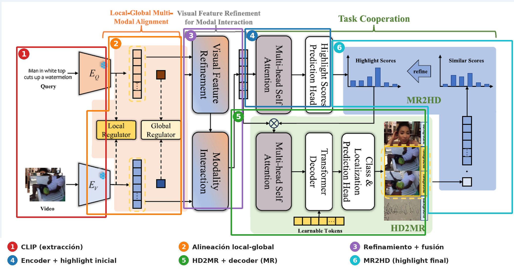
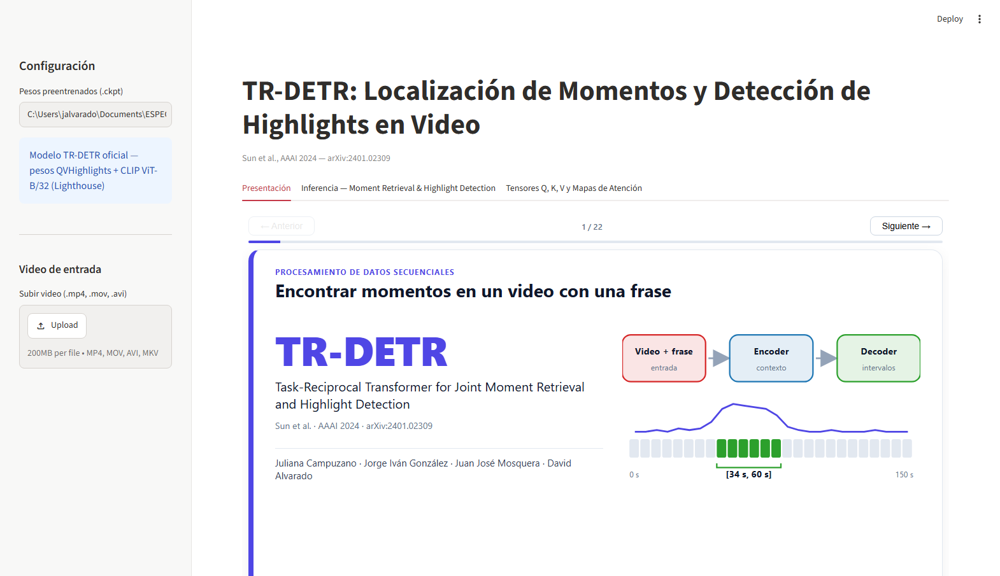
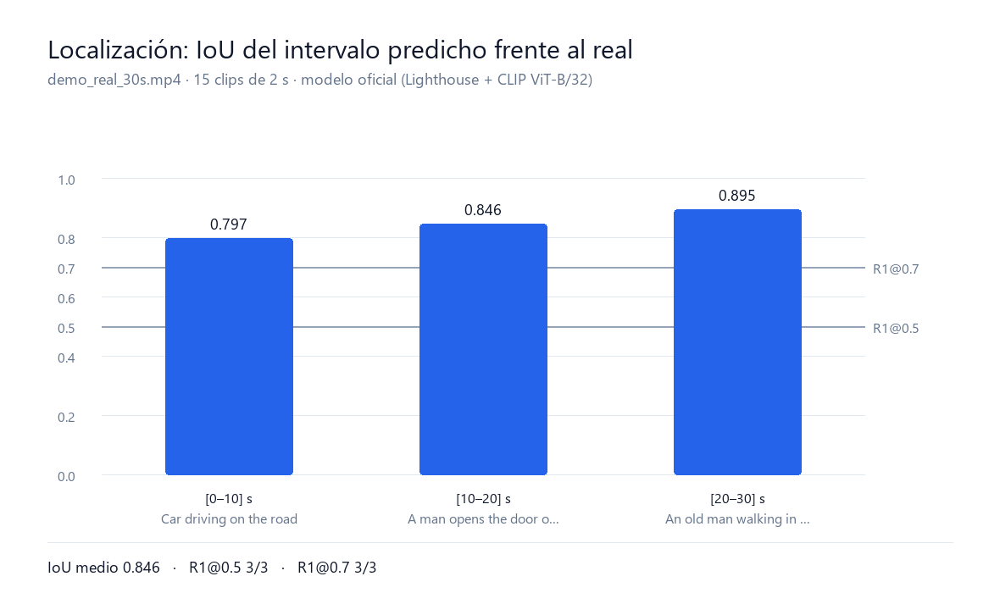
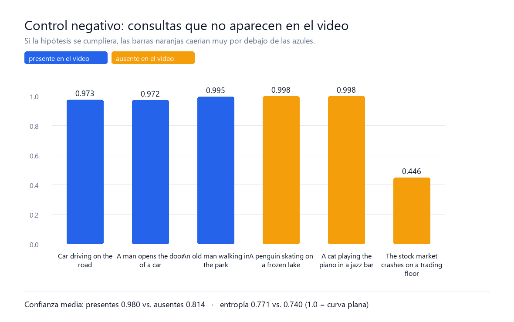
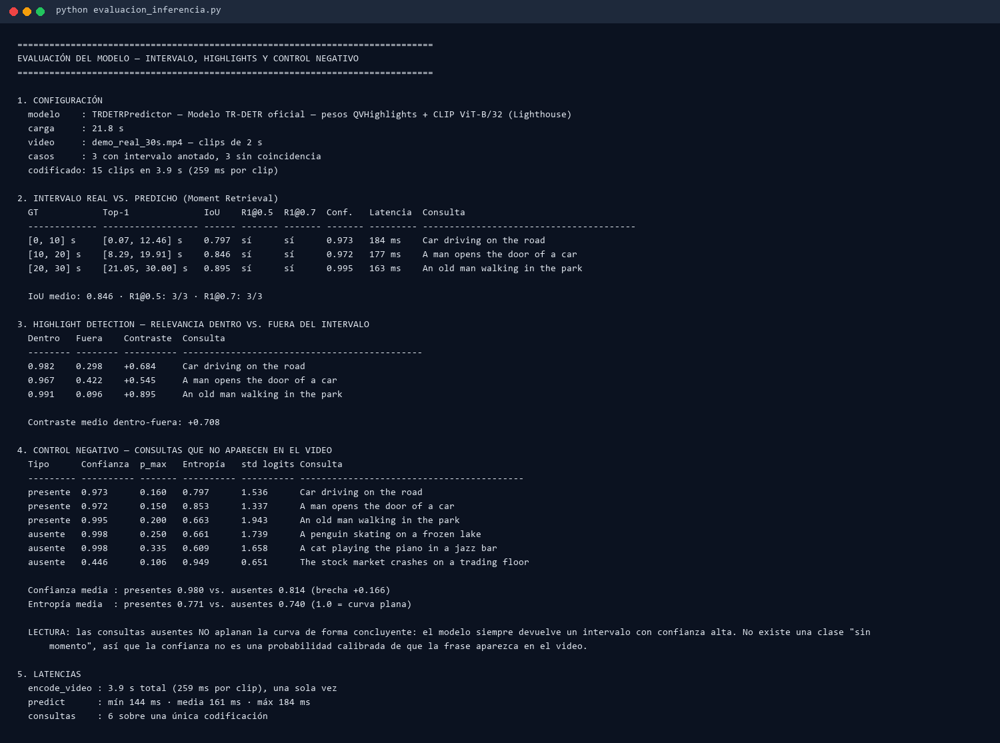

# TR-DETR: Localización de Momentos y Detección de Highlights en Video mediante Transformer Encoder–Decoder

**Proyecto Final — Procesamiento de Datos Secuenciales con Deep Learning**  
**Especialización en Inteligencia Artificial · Universidad Autónoma de Occidente (UAO)**  
**Docente:** Dra. Natalie Belandia  
**Integrantes:** Juliana Campuzano · Jorge Iván González · Juan José Mosquera · David Alvarado  

---

## 1. Resumen (Abstract)

Encontrar un momento específico dentro de un video de larga duración a partir de una descripción en lenguaje natural (por ejemplo, *"el hombre abre la puerta del carro"*) exige tradicionalmente inspeccionar la grabación de principio a fin de forma manual. En este proyecto se implementa y analiza el flujo de inferencia de **TR-DETR (*Task-Reciprocal Transformer for Joint Moment Retrieval and Highlight Detection*)**, una arquitectura **Transformer Encoder–Decoder** propuesta en **AAAI 2024** que resuelve de manera conjunta dos tareas sobre datos secuenciales multimodales: la **Recuperación de Momentos (*Moment Retrieval*, MR)** y la **Detección de Momentos Destacados (*Highlight Detection*, HD)**.

El sistema recibe como entrada una secuencia temporal de clips de video (extraídos cada $\Delta t = 2.0\text{ s}$ y codificados mediante **CLIP ViT-B/32**) junto con la secuencia de tokens de una consulta en lenguaje natural. A través de un módulo de **Alineación Local-Global (LGAM)**, un bloque de **Atención Cruzada Video-a-Texto (V2T)**, un **Transformer Encoder–Decoder** con $N_q = 10$ *Moment Queries* aprendibles y un mecanismo bidireccional de **Reciprocidad entre Tareas (`HD2MR` y `MR2HD` con celda GRU)**, el modelo predice simultáneamente las coordenadas temporales $[\text{inicio}, \text{fin}]$ del evento buscado y una curva continua de relevancia (*saliency score*) clip por clip. Se presenta una implementación modular en PyTorch junto con una interfaz gráfica interactiva en **Streamlit** que permite cargar videos propios, ejecutar consultas en vivo e inspeccionar la creación y dimensiones de los tensores **Query ($Q$)**, **Key ($K$)** y **Value ($V$)** en cada etapa de atención.

---

## 2. Introducción

### 2.1 Artículo Base y Repositorios Oficiales
- **Artículo científico base:** H. Sun, M. Zhou, W. Chen y W. Xie, “TR-DETR: Task-Reciprocal Transformer for Joint Moment Retrieval and Highlight Detection,” en *Proc. AAAI Conf. Artificial Intelligence*, vol. 38, no. 5, 2024, pp. 4998–5007. Preprint: `arXiv:2401.02309`.
- **Repositorio original de los autores:** [https://github.com/mingyao1120/TR-DETR](https://github.com/mingyao1120/TR-DETR)
- **Framework de inferencia reproducible y pesos preentrenados (QVHighlights, features CLIP):** [https://github.com/line/lighthouse](https://github.com/line/lighthouse) y [https://zenodo.org/records/13960580](https://zenodo.org/records/13960580) (`clip_tr_detr_qvhighlight.ckpt`, licencias MIT y Apache 2.0).

### 2.2 Contexto del Problema y Motivación
El crecimiento exponencial de contenido audiovisual en plataformas educativas, sistemas de videovigilancia, deportes y medios digitales ha vuelto ineficiente la búsqueda manual de eventos dentro de videos. A diferencia de la clasificación de video tradicional, la localización temporal guiada por lenguaje natural requiere:
1. **Alinear dos dominios secuenciales heterogéneos:** una secuencia visual continua discretizada en $L_v$ clips y una secuencia discreta de $L_t$ tokens lingüísticos.
2. **Delimitación temporal precisa (*Moment Retrieval*):** encontrar los límites exactos $[t_{\text{inicio}}, t_{\text{fin}}]$ donde ocurre la acción.
3. **Puntuación de relevancia (*Highlight Detection*):** asignar un valor escalar $s_t \in [0, 1]$ a cada clip $t$ según su correspondencia semántica con la consulta.

Arquitecturas previas basadas en DETR (como *Moment-DETR* o *QD-DETR*) predecían ambas tareas con cabezas independientes al final del Decoder, desaprovechando que saber *qué clips son relevantes* ayuda a delimitar el intervalo y saber *dónde empieza y termina el intervalo* ayuda a suprimir ruido fuera del evento.

### 2.3 Objetivo
Implementar el pipeline de preprocesamiento e inferencia de la arquitectura **Transformer Encoder–Decoder TR-DETR**, analizando en profundidad la generación matemática y operativa de los tensores $Q$, $K$ y $V$ en sus mecanismos de *Self-Attention* y *Cross-Attention*, y demostrando su funcionamiento en tiempo real mediante una interfaz gráfica interactiva.

---

## 3. Marco Teórico

### 3.1 Planteamiento general

TR-DETR (*Task-Reciprocal Detection Transformer*) es un modelo que recibe un video y una consulta en lenguaje natural, y resuelve de manera conjunta dos tareas. La primera, denominada *Moment Retrieval* (MR), consiste en localizar el intervalo de tiempo [inicio, fin] en el que ocurre lo descrito por la consulta. La segunda, *Highlight Detection* (HD), consiste en asignar a cada segmento de dos segundos del video un puntaje que indica qué tan relevante es frente a dicha consulta.

El modelo pertenece a la familia DETR, cuya característica principal es el uso de una arquitectura Transformer encoder–decoder en la que un conjunto fijo de consultas aprendidas predice directamente los resultados, sin necesidad de generar y ordenar candidatos de forma manual. El nombre *Task-Reciprocal* hace referencia a su principal aporte: las dos tareas no se resuelven de forma aislada, sino que cada una utiliza el resultado de la otra para mejorar su propia predicción.

Con el fin de facilitar la comprensión de cada etapa, a lo largo de esta sección se emplea un mismo ejemplo: la consulta *"A woman walking in a market"* aplicada sobre un video de 150 segundos, el cual se divide en 75 clips de 2 segundos.

### 3.2 Mecanismo de atención

El funcionamiento del modelo se fundamenta en la atención escalada por producto punto, definida como:

$$\text{Attention}(Q,K,V) = \text{softmax}\left(\frac{QK^T}{\sqrt d}\right)V$$

En esta expresión, la matriz Q (*Query*) representa aquello que busca información, la matriz K (*Key*) representa aquello contra lo cual se compara, y la matriz V (*Value*) contiene la información que finalmente se transmite. El producto $QK^T$ mide la similitud entre cada elemento de Q y cada elemento de K; la función softmax convierte esas similitudes en pesos que suman uno, y el factor $\sqrt d$ evita que los valores crezcan en exceso y saturen dicha función. Un aspecto que resultó clave para la comprensión del modelo es que la salida de la atención conserva una fila por cada elemento de Q, de modo que la elección de qué secuencia actúa como Q determina la forma del resultado.

Las matrices Q, K y V se obtienen al multiplicar la entrada por matrices de pesos ($W_Q$, $W_K$, $W_V$) que se aprenden durante el entrenamiento y permanecen fijas en la inferencia. Por el contrario, la matriz de atención resultante del softmax se recalcula para cada video y cada consulta. Cuando Q, K y V provienen de la misma secuencia se habla de *self-attention*; cuando Q proviene de una secuencia y K y V de otra, se habla de *cross-attention*. TR-DETR emplea ocho cabezas de atención en paralelo, cada una de 32 dimensiones (256/8), lo que permite que cada cabeza se especialice en un tipo de relación distinta.

### 3.3 Arquitectura por fases

Para su estudio, la arquitectura se dividió en seis fases, señaladas en la siguiente figura.



#### Fase 1: extracción de características con CLIP

El video se divide en clips de 2 segundos sin solapamiento. De cada clip se toma un fotograma, que el codificador de imágenes de CLIP (ViT-B/32) transforma en un vector de 512 dimensiones. De forma análoga, el codificador de texto de CLIP convierte cada palabra de la consulta en un vector de la misma dimensión:

$$F_v \in \mathbb{R}^{L\times 512},\qquad F_t \in \mathbb{R}^{N\times 512}$$

donde $L$ es el número de clips y $N$ el número de palabras. CLIP permanece congelado, es decir, sus pesos no se modifican. Su uso se justifica porque fue preentrenado con pares imagen–texto mediante una pérdida contrastiva, lo que hace que imágenes y palabras con el mismo significado queden representadas en un espacio común; por ejemplo, la imagen de un mercado y la palabra *"market"* producen vectores cercanos. Es importante señalar que CLIP procesa cada fotograma de manera independiente y, por lo tanto, no modela la secuencia temporal; esa tarea recae en las etapas posteriores de TR-DETR.

#### Fase 2: alineación multimodal local-global

Las características de video y texto se proyectan a la dimensión interna del modelo, $d = 256$, mediante dos perceptrones multicapa:

$$\hat F_v = \text{MLP}_v(F_v),\qquad \hat F_t = \text{MLP}_t(F_t)$$

Sobre estas representaciones actúan dos reguladores. Cabe aclarar que ambos son funciones de pérdida que solo intervienen durante el entrenamiento: no producen ninguna salida que continúe hacia adelante, sino que, mediante la retropropagación, ajustan los pesos de los MLP para que video y texto queden mejor alineados.

El regulador local compara cada clip con cada palabra mediante la similitud coseno, y promedia el resultado sobre las palabras para obtener un valor por clip:

$$S_{loc} = \sigma\left(\frac{\hat F_v \hat F_t^T}{\|\hat F_v\|\|\hat F_t\|}\right),\qquad \mathcal{L}_{local} = -\sum_{i=1}^{L}\left[C_i\log\hat S^i_{loc} + (1-C_i)\log(1-\hat S^i_{loc})\right]$$

En esta entropía cruzada binaria, $C_i$ toma el valor 1 si el clip $i$ pertenece al momento anotado manualmente en el dataset y 0 en caso contrario, mientras que $\hat S^i_{loc}$ es la similitud predicha. Debido al signo negativo y a que el logaritmo de un número entre 0 y 1 es negativo, la pérdida aumenta cuando el modelo asigna un valor bajo a un clip que sí era relevante, o un valor alto a uno que no lo era. De este modo, el modelo aprende a distinguir clips visualmente similares a la consulta pero que no corresponden al momento buscado.

El regulador global resume el video y la consulta en un único vector cada uno, $G_v$ y $G_t$, obtenidos como el promedio de los clips y de las palabras respectivamente, y aplica una pérdida contrastiva sobre el lote de entrenamiento:

$$\mathcal{L}_{global} = -\frac{1}{B}\sum_{i=1}^{B}\log\frac{\exp(G_v^i\cdot G_t^i)}{\sum_{j=1}^{B}\exp(G_v^i\cdot G_t^j)}$$

La fracción corresponde a la probabilidad de que el modelo identifique la consulta correcta de un video entre las $B$ consultas del lote. Las demás consultas actúan como ejemplos negativos, de manera que la pérdida obliga a acercar cada video a su consulta y a alejarlo de las restantes. Se entendió que el regulador local opera a una escala fina (clip–palabra) y el global a una escala general (video–consulta), por lo que ambos resultan complementarios.

#### Fase 3: refinamiento visual y fusión de modalidades

En el refinamiento visual se calcula una matriz de similitud entre clips y palabras:

$$A = \frac{\text{Linear}(\hat F_v)\,\text{Linear}(\hat F_t)^T}{\sqrt d} \in \mathbb{R}^{L\times N}$$

A esta matriz se le aplican dos normalizaciones softmax. En $A_r$, normalizada por filas, cada clip distribuye su atención entre las palabras; en $A_c$, normalizada por columnas, cada palabra distribuye su atención entre los clips. El siguiente ejemplo ilustra ambas matrices para tres clips del video:

```
A_r (por fila)   woman  walking  market        A_c (por columna)  woman  walking  market
clip calle        0.20    0.70    0.10          clip calle          0.10    0.60    0.05
clip mercado      0.40    0.10    0.50          clip mercado        0.80    0.30    0.90
clip cielo        0.33    0.33    0.33          clip cielo          0.10    0.10    0.05
```

En $A_r$ se observa que el clip del cielo reparte su atención de forma uniforme, lo que indica que no guarda relación con ninguna palabra. En $A_c$ se observa que la palabra *"market"* concentra su atención en el clip del mercado. A partir de estas matrices se calculan:

$$F_{v2q} = A_r\hat F_t \qquad F_{q2v} = A_r A_c^T \hat F_v$$

$F_{v2q}$ representa, para cada clip, la porción de la consulta que lo describe. $F_{q2v}$ representa, para cada clip, la apariencia que tienen en este video particular las palabras que le corresponden; es decir, ancla el concepto general de *"market"* a la forma en que el mercado aparece realmente en las imágenes. Ambas matrices tienen una fila por clip ($L\times 256$), lo que permite concatenarlas con las características originales:

$$F_v^{Cat} = [\hat F_v \,\|\, F_{v2q} \,\|\, \hat F_v\odot F_{v2q} \,\|\, \hat F_v\odot F_{q2v} \,\|\, F_t^G],\qquad F_v = \text{Linear}(F_v^{Cat})$$

Los productos elemento a elemento ($\odot$) toman valores altos cuando el clip y la información textual coinciden, y valores bajos cuando no lo hacen, por lo que los clips ajenos a la consulta quedan atenuados. El término $F_t^G$ corresponde a un resumen de la consulta replicado en cada clip.

Posteriormente, la fusión de modalidades se realiza mediante una *cross-attention*:

$$Z = \text{softmax}\left(\frac{Q_vK_t^T}{\sqrt d}\right)V_t$$

En esta etapa, Q proviene de los clips refinados, mientras que K y V provienen de las palabras de la consulta. La interpretación adoptada es que cada clip "pregunta" a la consulta qué relación tiene con ella y absorbe el significado de las palabras más relevantes. Se eligió a los clips como Q porque así la salida conserva un vector por clip y, con ello, el eje temporal del video; si la consulta actuara como Q, la salida tendría un vector por palabra y se perdería la información de en qué momento ocurre cada evento. El resultado, $Z\in\mathbb{R}^{L\times 256}$, son las características conjuntas: cada clip queda representado junto con la información de la consulta que le corresponde.

#### Fase 4: codificador y puntaje inicial de relevancia

El codificador aplica *self-attention* entre los clips, de modo que Q, K y V provienen de la misma secuencia y la matriz de atención tiene dimensión $L\times L$. A cada clip se le suma una codificación posicional que indica su ubicación en el tiempo. Gracias a esta etapa, cada clip incorpora información de sus vecinos, lo que aporta contexto temporal y favorece que los momentos detectados resulten continuos. El codificador consta de dos capas, cada una formada por una *self-attention* seguida de una red *feed-forward* (256 → 1024 → 256).

Sobre la salida del codificador, una capa lineal convierte el vector de cada clip en un único valor, que constituye un puntaje preliminar de relevancia:

$$H = \text{Linear}(\text{MHA}(Z)) \in \mathbb{R}^{L}$$

#### Fase 5: HD2MR y decodificador

En el componente HD2MR, los puntajes preliminares se utilizan para atenuar los clips poco relevantes antes de buscar el intervalo. Para ello se multiplican por las características conjuntas y el resultado se procesa nuevamente con el mismo codificador, es decir, con los mismos pesos:

$$\bar Z = \text{softmax}(H)\odot Z,\qquad \hat Z = \text{MHA}(Z + \bar Z)$$

La suma con $Z$ actúa como una conexión residual: evita que la información original se pierda, de manera que los clips relevantes se refuerzan sin que los demás desaparezcan por completo. Esto también protege al modelo frente a posibles errores en los puntajes preliminares.

El decodificador recibe diez *moment queries*, que pueden entenderse como diez "buscadores" aprendidos. Cada una parte de un ancla temporal fija, definida por un centro y un ancho normalizados entre 0 y 1, y realiza una *cross-attention* en la que Q corresponde a las *moment queries*, mientras que K y V corresponden a la memoria $\hat Z$ del codificador. Las *moment queries* no reciben la consulta de forma directa; esta ya se encuentra incorporada en la memoria desde la fase 3. Así, el ancla indica dónde comenzar a buscar y la memoria indica qué clips son relevantes. En cada una de las dos capas del decodificador, la query ajusta su centro y su ancho para acercarse al momento real.

La salida del decodificador (10 × 256) se procesa con dos cabezas. La cabeza de localización, un MLP de tres capas, predice el centro y el ancho del intervalo, lo que constituye una tarea de regresión. La cabeza de clase, una capa lineal, determina si la propuesta corresponde a un momento real o a fondo, lo que constituye una tarea de clasificación cuya probabilidad se utiliza como confianza. Por ejemplo, un centro de 0.31 y un ancho de 0.17 en un video de 150 segundos corresponden al intervalo [34 s, 60 s]. Durante el entrenamiento, el algoritmo de emparejamiento húngaro asigna cada momento real a la query que mejor lo aproxima, mientras que las restantes aprenden a clasificarse como fondo.

#### Fase 6: MR2HD y puntaje final de relevancia

En el componente MR2HD, el intervalo de mayor confianza se utiliza para refinar los puntajes de relevancia. Los clips contenidos en dicho intervalo se procesan, en orden temporal, mediante una red recurrente GRU, que los resume en un único vector $F^M_v$. Este vector puede interpretarse como una representación visual del momento encontrado, y se compara con cada clip del video:

$$F^M_v = \text{GRU}(m),\qquad S_{ref} = \frac{F^M_v\hat F_v^T}{\|F^M_v\|\|\hat F_v\|},\qquad H = \text{Linear}(Z + \text{softmax}(S_{ref})\odot\hat Z)$$

El vector $S_{ref}$ mide qué tanto se parece cada clip al momento encontrado y se utiliza para reforzar las características de los clips similares, a partir de las cuales se recalcula el puntaje. Se comprendió que este mecanismo resulta útil en casos donde un clip no se asemeja claramente a la consulta, pero sí al momento detectado; por ejemplo, un clip en el que la persona aparece de espaldas dentro del mismo mercado. El puntaje $H$ obtenido en esta fase constituye la salida final de la tarea de HD, mientras que el puntaje preliminar de la fase 4 solo se emplea para apoyar la búsqueda del intervalo.

### 3.4 Función de pérdida

Durante el entrenamiento, el modelo optimiza de manera conjunta una única función de pérdida:

$$\mathcal{L}_{total} = \mathcal{L}_{mom} + \mathcal{L}_{high} + \lambda_g(\mathcal{L}_{local} + \mathcal{L}_{global}),\qquad \lambda_g = 0.3$$

Todos los parámetros se actualizan simultáneamente, con excepción de CLIP, que permanece congelado. Las pérdidas $\mathcal{L}_{local}$ y $\mathcal{L}_{global}$ se describieron en la fase 2; las dos restantes se heredan del modelo QD-DETR.

La pérdida de recuperación de momentos, $\mathcal{L}_{mom}$, compara los intervalos predichos con los intervalos anotados manualmente. Como el modelo produce diez propuestas y cada video tiene uno o pocos momentos reales, primero se aplica el emparejamiento húngaro, que asigna cada momento real a la propuesta que mejor lo aproxima. Sobre cada pareja se calcula:

$$\mathcal{L}_{mom} = \lambda_{L1}\,\|m - \hat m\|_1 + \lambda_{gIoU}\,\mathcal{L}_{gIoU}(m,\hat m) + \lambda_{cls}\,\mathcal{L}_{CE}$$

El término L1 mide la diferencia absoluta entre el centro y el ancho reales ($m$) y los predichos ($\hat m$). El término gIoU penaliza el bajo traslape entre ambos intervalos, incluso cuando no se superponen. Finalmente, la entropía cruzada $\mathcal{L}_{CE}$ evalúa la clasificación: la propuesta emparejada debe clasificarse como momento, y las restantes, como fondo.

La pérdida de detección de relevancia, $\mathcal{L}_{high}$, compara los puntajes predichos por clip con las calificaciones de 0 a 4 asignadas por anotadores humanos. En lugar de exigir valores exactos, evalúa el orden relativo de los clips mediante dos componentes:

$$\mathcal{L}_{marg} = \max\left(0,\; \Delta + S(x_{neg}) - S(x_{pos})\right),\qquad \mathcal{L}_{rank} = -\sum_{r}\log\frac{\sum_{i\in P_r} e^{S_i}}{\sum_{j} e^{S_j}}$$

En la pérdida de margen, un clip relevante ($x_{pos}$) debe obtener un puntaje superior al de uno poco relevante ($x_{neg}$) en al menos un margen $\Delta$. La pérdida contrastiva por rangos, evaluada para distintos umbrales de calificación $r$, favorece que el conjunto de clips que supera cada umbral ($P_r$) se ubique en las primeras posiciones. Como consecuencia, el modelo aprende a ordenar los clips y no a producir valores absolutos, lo que explica que los puntajes entregados en la inferencia puedan ser negativos y deban normalizarse para su visualización.

En el presente trabajo no se realizó entrenamiento; se emplearon los pesos preentrenados sobre el dataset QVHighlights, por lo que estas pérdidas se describen con el fin de explicar cómo aprendió el modelo.

### 3.5 Innovaciones del modelo

La principal innovación de TR-DETR es la reciprocidad entre tareas. En los métodos anteriores de la misma familia, como Moment-DETR y QD-DETR, MR y HD compartían la extracción de características, pero se resolvían con cabezas independientes que no intercambiaban información. En TR-DETR, la detección de relevancia ayuda a la localización del momento (HD2MR), al atenuar los clips poco relevantes antes de la decodificación, y la localización del momento ayuda a la detección de relevancia (MR2HD), al proporcionar una referencia visual del momento encontrado.

A esta se suman otras dos contribuciones: la alineación local-global de video y texto antes de su interacción, y el refinamiento visual guiado por la consulta. Según el estudio de ablación presentado por los autores, cada componente mejora el desempeño de manera individual, y la alineación resulta determinante: sin ella, la reciprocidad entre tareas puede incluso deteriorar los resultados, debido a que las tareas se transmiten errores cuando video y texto no se encuentran bien alineados.

---

## 4. Metodología

1. **Segmentación Temporal del Video:** Todo video de entrada con duración $T$ segundos se divide en $L_v = \lceil T / \Delta t \rceil$ clips no solapados de $\Delta t = 2.0\text{ s}$ (estándar del benchmark **QVHighlights**), utilizando `FFmpeg`.
2. **Extracción de Características Secuenciales:**
   - **Secuencia Visual ($F_v$):** Cada clip de 2 segundos se codifica en un vector de dimensión $D_v = 512$ (espacio visual CLIP ViT-B/32), conformando el tensor $(1, L_v, 512)$.
   - **Secuencia Textual ($F_t$):** La consulta en lenguaje natural se tokeniza agregando los marcadores especiales de inicio y fin de secuencia (`<sos>`, $w_1, \dots, w_m$, `<eos>`) y se codifica en el tensor $(1, L_t, 512)$.
3. **Inferencia con Pesos Preentrenados y Trazabilidad en PyTorch:**
   - El motor `TRDETRInferenceEngine` (`inference.py`) carga el checkpoint oficial `clip_tr_detr_qvhighlight.ckpt` (Zenodo, `record/13960580`) con `lighthouse.models.TRDETRPredictor`. Los intervalos, la curva de relevancia y el número de clips salen directamente del modelo oficial.
   - Los mapas de atención se extraen del mismo modelo con *forward hooks* de PyTorch registrados durante `predictor.predict()` (y retirados al terminar), sin modificar el código de Lighthouse: fusión clip←palabra (`transformer.t2v_encoder.layers[i].self_attn`, $L \times N$), self-attention del encoder (`transformer.encoder.layers[i].self_attn`, $L \times L$) y cross-attention del decoder (`transformer.decoder.layers[i].cross_attn`, $10 \times L$). Cada mapa es el promedio de las 8 cabezas.

---

## 5. Desarrollo e Implementación

### 5.1 Estructura del Repositorio

```text
ProyectoFinal_DatosSecuenciales/
├── tr_detr_model.py      # Reimplementación didáctica de TR-DETR (referencia; la app no la usa)
├── inference.py          # Motor de inferencia sobre Lighthouse, hooks de atención y CLI
├── app.py                # Interfaz Streamlit con tres pestañas: Presentación, Inferencia y Mapas Q,K,V
├── slides.py             # Presentación interactiva de la arquitectura, renderizada como componente HTML
├── download_weights.py   # Descarga y verifica (tamaño + MD5) el checkpoint oficial de Zenodo (13960580)
├── flujo_inferencia.py   # Flujo oficial encode_video -> predict, con tiempos y formas de los tensores
├── evaluacion_inferencia.py # Métricas propias: IoU, R1@0.5/0.7, contraste de highlights y control negativo
├── requirements.txt      # Dependencias del proyecto (streamlit >= 1.33, torch, numpy, etc.)
├── requirements-lighthouse.txt # Dependencias extra para inferencia oficial con CLIP + Lighthouse
├── assets/               # Diagrama de fases, captura de la app y figuras de resultados
├── sample_data/          # Videos de prueba: demo_real_30s.mp4 (real, 3 escenas) y demo_video_eventos.mp4 (bloques de color)
└── weights/              # Carpeta destino para el checkpoint preentrenado (.ckpt)
```

### 5.2 Pasos para Ejecutar el Proyecto

#### Paso 1: Crear entorno virtual e instalar dependencias
```powershell
python -m venv venv
.\venv\Scripts\Activate.ps1
pip install -r requirements.txt
```

#### Paso 2: Descargar el archivo de pesos preentrenados desde Zenodo
```powershell
python download_weights.py
```
*(La app necesita el checkpoint en `weights/clip_tr_detr_qvhighlight.ckpt`).*

#### Paso 2b: Habilitar la inferencia oficial con Lighthouse
La app ejecuta exclusivamente el modelo oficial, así que Lighthouse es obligatorio:

```powershell
pip install -r requirements-lighthouse.txt
pip install --no-deps git+https://github.com/line/lighthouse.git
```

La primera vez que se ejecuta, Lighthouse descarga el modelo CLIP ViT-B/32 (~350 MB). La app muestra en la barra lateral:

- **“Modelo TR-DETR oficial — pesos QVHighlights + CLIP ViT-B/32 (Lighthouse)”** cuando la inferencia oficial está activa.
- Un mensaje de error con la excepción real cuando Lighthouse o el checkpoint no están disponibles; en ese caso no se muestran resultados.

En Windows, `inference.py` adapta automáticamente Lighthouse: crea un shim de FFmpeg a partir de `imageio-ffmpeg` y evita el uso de `ffprobe` en el cargador de frames.

#### Paso 3: Ejecutar la inferencia por consola (CLI)
```powershell
python inference.py --video sample_data/demo_real_30s.mp4 --query "A man opens the door of a car"
```

#### Paso 4: Iniciar la Interfaz Gráfica Interactiva en Streamlit
```powershell
streamlit run app.py
```
La interfaz se organiza en tres pestañas: **Presentación** (diapositivas de la arquitectura), **Inferencia** (carga de video, consulta y resultados) y **Tensores Q, K, V** (mapas de atención del modelo).



*Figura 1 — App en ejecución: el motor oficial queda cargado en la barra lateral y la pestaña Presentación muestra el deck (1/22).*

#### Paso 5: Verificar los pesos y reproducir las métricas
```powershell
python download_weights.py --check    # comprueba tamaño y MD5 del checkpoint local
python flujo_inferencia.py            # flujo encode_video -> predict con tiempos medidos
python evaluacion_inferencia.py       # IoU, R1@0.5/0.7, contraste de highlights y control negativo
```

`download_weights.py` compara el archivo con el tamaño y el MD5 publicados por Zenodo, de modo que una descarga incompleta o corrupta se detecta antes de cargar el modelo. Los dos scripts siguientes imprimen sus tablas en consola; `evaluacion_inferencia.py --json ruta.json` permite volcar los resultados.

#### Demostración recomendada
Con Lighthouse activo, usar el video real compuesto de 30 segundos:

```
sample_data/demo_real_30s.mp4
```

Contiene tres escenas reales: `[0–10 s]` carro conduciendo, `[10–20 s]` hombre abriendo la puerta de un carro en un parqueadero y `[20–30 s]` anciano caminando en un parque.

Consultas y resultados verificados:

| Consulta | Top-1 predicho | Confianza | Escena real |
|---|---|---|---|
| `Car driving on the road` | 0.07–12.46 s | 97.3 % | 0–10 s |
| `A man opens the door of a car` | 8.29–19.91 s | 97.2 % | 10–20 s |
| `An old man walking in the park` | 21.05–30.0 s | 99.5 % | 20–30 s |

> El video `sample_data/demo_video_eventos.mp4` (bloques de color) sigue disponible para pruebas del pipeline, pero **no es adecuado para la demo con el modelo oficial**: CLIP no encuentra semántica real en bloques de color.

---

## 6. Resultados y Análisis

### 6.1 Métricas de Desempeño en el Benchmark Oficial QVHighlights
En el conjunto de prueba de **QVHighlights** (videos reales de noticias y vlogs de 150 segundos divididos en 75 clips de 2 segundos), las métricas estándar evalúan:
- **Recall@1 ($\text{R1}@\text{IoU}$):** Porcentaje de consultas donde el intervalo predicho con mayor confianza ($\text{Top-1}$) tiene una Intersección sobre Unión ($\text{IoU}$) mayor o igual a $0.5$ o $0.7$ respecto al intervalo real (*Ground Truth*).
- **Mean Average Precision ($\text{mAP}$):** Precisión promedio sobre las 10 propuestas del Decoder en umbrales de $\text{IoU} \in [0.5 : 0.05 : 0.95]$.
- **HIT@1 (Highlight Detection):** Porcentaje de veces en que el clip con puntaje de relevancia más alto ($s_t$) coincide con un clip etiquetado como *"Very Good"* por los anotadores humanos.

| Modelo | Año / Conferencia | Modalidad | **R1@0.5 (%)** | **R1@0.7 (%)** | **mAP@0.5 (%)** | **mAP@0.75 (%)** | **Avg. mAP (%)** | **HIT@1 (%)** |
| :--- | :---: | :---: | :---: | :---: | :---: | :---: | :---: | :---: |
| **Moment-DETR** | NeurIPS 2021 | Video (SF+CLIP) | 52.89 | 33.02 | 54.82 | 29.40 | 30.73 | 55.60 |
| **UMT** | CVPR 2022 | Video + Audio | 56.23 | 41.18 | 53.38 | 37.01 | 36.12 | 59.99 |
| **UniVTG** | CVPR 2023 | Video (SF+CLIP) | 58.86 | 40.86 | 57.60 | 35.59 | 35.47 | 60.96 |
| **QD-DETR** | CVPR 2023 | Video (SF+CLIP) | 62.40 | 44.98 | 62.62 | 39.88 | 39.86 | 62.40 |
| **TR-DETR (Artículo Base)** | **AAAI 2024** | **Video (SF+CLIP)** | **64.66** | **48.96** | **63.98** | **43.73** | **42.62** | **63.42** |
| **TR-DETR Multimodal** | **AAAI 2024** | **Video + Audio** | **65.05** | **47.67** | **64.87** | **42.98** | **43.10** | **63.88** |

*Conjunto de prueba de QVHighlights; se omite la columna de mAP de highlight detection por claridad (TR-DETR: 39.91, TR-DETR multimodal: 39.90).*

**Análisis cuantitativo:**
1. **Salto en localización estricta ($\text{R1}@0.7$):** TR-DETR supera a Moment-DETR en **+15.94 puntos porcentuales** ($48.96\%$ vs. $33.02\%$) y a QD-DETR en **+3.98 puntos**, demostrando que inyectar los puntajes de highlight en la memoria del Encoder (`HD2MR`) permite a las *Moment Queries* ajustar con mucha mayor exactitud los bordes de inicio y fin del evento.
2. **Reciprocidad y detección de highlights ($\text{HIT}@1$):** el modelo completo alcanza **$63.42\%$** de $\text{HIT}@1$; la ablación (§6.2) matiza de dónde viene esa mejora: la reciprocidad entre tareas aporta sobre todo **cuando ya existe alineación multimodal**, y `MR2HD` aislado apenas mueve el $\text{HIT}@1$.

### 6.2 Ablación de módulos (Table 4 del artículo)

La Table 4 del artículo parte de un *baseline* (Moment-DETR con el decoder de DAB-DETR) y mide, sobre el **conjunto de validación** de QVHighlights, el efecto de añadir cada módulo:

| Configuración | LGAM | VFR | MR2HD | HD2MR | R1@0.5 | R1@0.7 | mAP@0.5 | mAP@0.75 | Avg. mAP | HIT@1 |
| :--- | :---: | :---: | :---: | :---: | ---: | ---: | ---: | ---: | ---: | ---: |
| (a) baseline | | | | | 57.72 | 42.35 | 59.10 | 38.16 | 38.03 | 57.44 |
| (b) + LGAM | ✔ | | | | 63.10 | 44.97 | 63.13 | 40.22 | 40.47 | 63.87 |
| (c) + VFR | | ✔ | | | 64.19 | 47.61 | 63.50 | 42.90 | 41.74 | 64.13 |
| (d) + MR2HD | | | ✔ | | 58.39 | 42.71 | 59.28 | 39.19 | 38.76 | 58.80 |
| (e) + HD2MR | | | | ✔ | 59.61 | 42.26 | 60.91 | 39.28 | 39.26 | 58.45 |
| (f) + MR2HD + HD2MR | | | ✔ | ✔ | 59.81 | 44.71 | 60.25 | 39.33 | 39.80 | 57.94 |
| (g) + LGAM + VFR | ✔ | ✔ | | | 62.13 | 47.16 | 62.00 | 42.79 | 41.21 | 62.65 |
| (h) + LGAM + VFR + MR2HD | ✔ | ✔ | ✔ | | 63.23 | 46.90 | 63.30 | 42.47 | 41.64 | 59.55 |
| (i) + LGAM + VFR + HD2MR | ✔ | ✔ | | ✔ | 66.32 | 50.71 | 65.71 | 44.82 | 43.95 | 64.90 |
| (j) todos los módulos | ✔ | ✔ | ✔ | ✔ | **67.10** | **51.48** | **66.27** | **46.42** | **45.09** | 64.77 |

*Mismas columnas que la Table 1; se omite la columna de mAP de highlight detection por claridad.*

**Lectura de la ablación:**

1. **La alineación multimodal es lo que más aporta por separado:** LGAM suma **+5.38** R1@0.5 (b) y VFR **+6.47** (c) sobre el baseline.
2. **La reciprocidad sin alineación casi no aporta:** MR2HD +0.67 (d), HD2MR +1.89 (e) y ambos juntos +2.09 (f), con el HIT@1 estancado (57.44 → 57.94).
3. **Con alineación previa el efecto se dispara:** partiendo de (g) 62.13, añadir HD2MR lleva a (i) **66.32** (+4.19 R1@0.5, +3.55 R1@0.7); añadir sólo MR2HD lleva a (h) 63.23 (+1.10) **pero hunde el HIT@1 de 62.65 a 59.55**.
4. **El modelo completo (j)** es el mejor en localización (67.10 / 51.48), con el HIT@1 prácticamente empatado con (i) (64.77 vs 64.90).

> **Conclusión:** la reciprocidad entre tareas no es un aditivo gratis; rinde cuando las dos modalidades ya comparten espacio semántico. Es la explicación que da el propio artículo para la caída de la configuración (h).

### 6.3 Resultados propios y verificación experimental

Los valores de esta sección los produce `python evaluacion_inferencia.py` sobre `sample_data/demo_real_30s.mp4` (15 clips de 2 s; tres escenas anotadas de 10 s) con el checkpoint oficial (`clip_tr_detr_qvhighlight.ckpt`, MD5 `941148ee…761b`). Son **medidas propias en un video de demostración**: no son cifras del benchmark y no deben compararse con la Table 1.

Para inspeccionar las dimensiones internas y las ventanas que devuelve el modelo oficial se ejecutó además:

```powershell
python inference.py --video sample_data/demo_real_30s.mp4 --query "A man opens the door of a car"
```

El video real compuesto tiene 30 segundos y tres escenas: `[0–10 s]` carro conduciendo, `[10–20 s]` hombre abriendo la puerta de un carro y `[20–30 s]` anciano caminando en un parque.

- **Mapas de atención extraídos del modelo oficial** (15 clips de 2 s, 10 tokens CLIP `['<sos>', 'a', 'man', 'opens', 'the', 'door', 'of', 'a', 'car', '<eos>']`; 2 capas por bloque, promedio de 8 cabezas):
  - Fusión clip←palabra (`t2v_encoder`): `(15, 10)` por capa. El módulo atiende a las 77 posiciones de texto de CLIP; se recorta a los 10 tokens reales (el relleno está enmascarado y cada fila suma 1).
  - Self-attention del encoder: `(15, 15)` por capa. El encoder se ejecuta dos veces (tras la fusión y dentro de HD2MR); la app muestra por defecto la pasada HD2MR, que es la memoria del decoder.
  - Cross-attention del decoder: `(10, 15)` por capa (*10 Moment Queries* × clips).
- **Localización obtenida con el modelo oficial:** Top-1 `[8.29 s – 19.91 s]` con **97.2 %** de confianza, correspondiente a la segunda escena (`[10–20 s]`). La curva de relevancia concentra su pico entre los clips 5 y 10.

> **Nota:** todo lo que muestra la app (intervalos, relevancia y mapas de atención) proviene del modelo oficial (Lighthouse + checkpoint de QVHighlights + CLIP ViT-B/32). Los mapas se leen con *forward hooks* sobre sus módulos de atención durante la predicción.

#### 6.3.1 Localización: intervalo real vs. predicho

| Intervalo real | Top-1 predicho | IoU | R1@0.5 | R1@0.7 | Confianza |
| :---: | :---: | ---: | :---: | :---: | ---: |
| [0, 10] s | [0.07, 12.46] s | 0.797 | ✔ | ✔ | 0.973 |
| [10, 20] s | [8.29, 19.91] s | 0.846 | ✔ | ✔ | 0.972 |
| [20, 30] s | [21.05, 30.00] s | 0.895 | ✔ | ✔ | 0.995 |



*Figura 2 — IoU del intervalo Top-1 en cada escena; las líneas horizontales marcan los umbrales de R1@0.5 y R1@0.7.*

**IoU medio 0.846 · R1@0.5 = 3/3 · R1@0.7 = 3/3.** El modelo acierta las tres escenas, pero sus ventanas son **más anchas** que el intervalo anotado (entre +1 y +2,5 s de margen en los bordes): es el comportamiento esperado de la cabeza L1 sin ajuste fino en el dominio.

#### 6.3.2 Detección de highlights: relevancia dentro vs. fuera

| Dentro del intervalo | Fuera del intervalo | Contraste |
| ---: | ---: | ---: |
| 0.982 | 0.298 | +0.684 |
| 0.967 | 0.422 | +0.545 |
| 0.991 | 0.096 | +0.895 |

**Contraste medio +0.708:** la curva concentra la relevancia dentro del intervalo (≈0.98) y la mantiene baja fuera (≈0.27), es decir, además de localizar, el modelo **ordena** los clips correctamente.

#### 6.3.3 Control negativo: consultas que no aparecen en el video

| Tipo | Consulta | Confianza | p_max | Entropía (1.0 = plana) |
| :--- | :--- | ---: | ---: | ---: |
| presente | Car driving on the road | 0.973 | 0.160 | 0.797 |
| presente | A man opens the door of a car | 0.972 | 0.150 | 0.853 |
| presente | An old man walking in the park | 0.995 | 0.200 | 0.663 |
| **ausente** | A penguin skating on a frozen lake | **0.998** | 0.250 | 0.661 |
| **ausente** | A cat playing the piano in a jazz bar | **0.998** | 0.335 | 0.609 |
| ausente | The stock market crashes on a trading floor | 0.446 | 0.106 | 0.949 |

**Hallazgo: la hipótesis "una frase ausente aplana la curva" no se cumple.** Dos de las tres consultas que no aparecen en el video reciben **0.998** de confianza —más que las correctas— y una entropía *menor*, es decir curvas **más picudas**. Sólo una frase de un dominio completamente ajeno ("stock market") baja a 0.446 y se acerca a la curva plana (entropía 0.949).



*Figura 3 — Confianza del Top-1 por consulta. Dos de las tres consultas ausentes (naranja) igualan o superan a las correctas.*

La explicación es estructural: TR-DETR se entrenó con **una consulta por video** y no tiene una clase "sin momento"; el modelo **siempre** devuelve una ventana. La consulta decide *dónde*, no *si*. Por tanto la confianza del Top-1 sirve como **umbral grosero de abstención**, no como probabilidad calibrada de que la frase aparezca en el video.

#### 6.3.4 Latencias

| Etapa | Medición |
| :--- | :--- |
| Carga del modelo | 15–95 s según el caché de disco y la carga de la CPU |
| `encode_video` | 3,4–5,0 s para 15 clips (229–279 ms por clip), **una sola vez** |
| `predict` | 0,07–0,18 s por consulta según la carga de la CPU (media ≈0,1 s) |



*Figura 4 — Salida de `python evaluacion_inferencia.py`: configuración, localización, contraste de highlights, control negativo y latencias (todas las cifras de esta sección).*

---

## 7. Conclusiones

1. **Aprendizajes clave sobre el mecanismo de Cross-Attention:** La implementación permitió comprobar que el éxito de una arquitectura Transformer Encoder–Decoder multimodal radica en la asignación asimétrica de $Q$, $K$ y $V$. Mientras que en la fusión temprana (**V2T**) los clips de video actúan como *Queries* ($Q_v$) para filtrar palabras relevantes del texto ($K_t, V_t$), en el **Decoder** son las *Moment Queries* aprendibles ($Q_{\text{dec}}$) las que interrogan a la secuencia temporal de clips codificados ($K_{\text{enc}}, V_{\text{enc}}$) para regresar directamente las coordenadas $(\hat{c}_i, \hat{w}_i)$ del intervalo sin necesidad de generación autorregresiva token por token.
2. **Sinergia entre arquitecturas Transformer y celdas recurrentes (GRU):** TR-DETR demuestra que las redes recurrentes vistas en la Semana 3 del curso (como GRU/LSTM) siguen siendo altamente efectivas cuando se integran dentro de un Transformer moderno (en el módulo `MR2HD`) para condensar secuencias locales de características.
3. **Limitaciones identificadas** (cada una con la medición que la respalda):
   - **No existe una clase "sin momento":** TR-DETR se entrenó con una consulta por video y siempre devuelve una ventana. Medido en §6.3.3: dos de tres consultas ausentes obtienen **0.998** de confianza, con curvas *más picudas* que las correctas. La confianza no es una probabilidad calibrada.
   - **Ventanas más anchas que el evento:** IoU medio **0.846** con R1@0.7 de 3/3, pero con un margen de **+1 a +2,5 s** en los bordes; sin ajuste fino en el dominio el modelo prefiere cubrir de más.
   - **Techo de 75 clips (150 s) por video:** `encode_video` lanza `ValueError` al superarlo porque el embedding posicional no soporta secuencias más largas.
   - **Resolución temporal de 2 s:** acciones de menos de un segundo quedan diluidas dentro de un clip; el borde del intervalo no puede ser más preciso que $\Delta t$.
   - **Dependencia de extractores congelados (CLIP):** con el video de bloques de color la curva queda **plana** (entropía normalizada 1.00, confianza 0.19): si CLIP no capta la semántica, el Transformer no puede recuperarla.
   - **Coste de arranque:** 15–95 s de carga del modelo según el caché de disco y la CPU; la primera vez incluye descargar ~350 MB de pesos de CLIP.
   - **Dependencia del entorno:** Lighthouse requiere instalarse sin dependencias (`--no-deps`), `torchaudio` emparejado con `torch` y, en Windows, el parche de FFmpeg/`ffprobe` que aplica `inference.py`.

4. **Posibles mejoras futuras** (priorizadas según la limitación que atacan):
   - **Calibrar un umbral de abstención** sobre QVHighlights val (confianza + entropía) para responder "no está en el video" — ataca la limitación 1, que es la más visible en la demo.
   - **Ajuste fino del `fuser`** con ~200 ejemplos del dominio: recupera bordes más ajustados y sube el contraste en videos propios (limitaciones 2 y 5).
   - **Muestreo adaptativo de clips** ($\Delta t = 1$ s en zonas de alto movimiento) para eventos breves (limitación 4).
   - **Troceo con solape de un clip** y fusión por NMS temporal para videos de más de 150 s (limitación 3).
   - **Precarga del modelo al iniciar la app** (la app ya usa `st.cache_resource`; falta hacerlo en el arranque) para que la primera consulta no espere la carga (limitación 6).
   - **Variante con audio (V+A):** el artículo reporta **+0.39 R1@0.5** pero **−1.29 R1@0.7** al añadir PANN; el audio ayuda a *encontrar* el momento, no a *ajustar los bordes*, así que sólo conviene si el caso de uso prioriza el recall.

---

## 8. Referencias (Formato IEEE)

[1] H. Sun, M. Zhou, W. Chen, and W. Xie, “TR-DETR: Task-Reciprocal Transformer for Joint Moment Retrieval and Highlight Detection,” in *Proc. AAAI Conf. Artif. Intell.*, vol. 38, no. 5, pp. 4998–5007, Mar. 2024, doi: 10.1609/aaai.v38i5.28304.

[2] A. Vaswani *et al.*, “Attention is all you need,” in *Advances in Neural Information Processing Systems (NeurIPS)*, vol. 30, Long Beach, CA, USA, 2017, pp. 5998–6008.

[3] N. Carion, F. Massa, G. Synnaeve, N. Usunier, A. Kirillov, and S. Zagoruyko, “End-to-end object detection with transformers,” in *Proc. Eur. Conf. Comput. Vis. (ECCV)*, Glasgow, UK, 2020, pp. 213–229.

[4] J. Lei, Tamara L. Berg, and M. Bansal, “Detecting moments and highlights in videos via natural language queries,” in *Advances in Neural Information Processing Systems (NeurIPS)*, vol. 34, 2021, pp. 11846–11858.

[5] W. Moon, S. Hyun, S. Park, D. Park, and J.-P. Heo, “Query-dependent video representation for moment retrieval and highlight detection,” in *Proc. IEEE/CVF Conf. Comput. Vis. Pattern Recognit. (CVPR)*, Vancouver, BC, Canada, 2023, pp. 23023–23033.

[6] A. Radford *et al.*, “Learning transferable visual models from natural language supervision,” in *Proc. Int. Conf. Mach. Learn. (ICML)*, vol. 139, 2021, pp. 8748–8763.

[7] T. Nishimura, “Lighthouse: A user-friendly library for reproducible video moment retrieval and highlight detection,” LINE Corporation, 2024. [Online]. Available: https://github.com/line/lighthouse and https://zenodo.org/records/13960580
